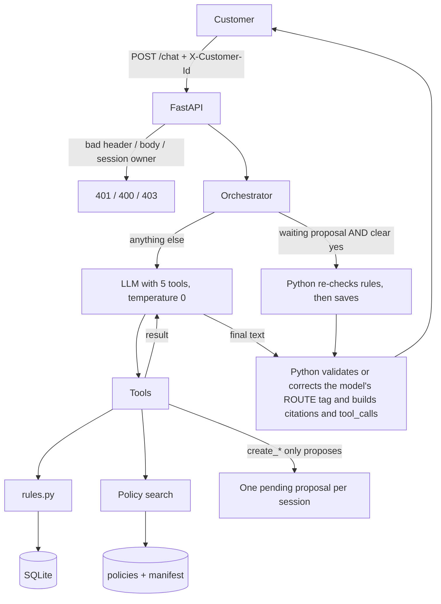

# ResolveBot

A customer-support chat assistant for the fictional store ShopSphere. It answers questions about orders, returns, warranties, cancellations and store policy from the store's own data, and changes nothing until the customer clearly says "yes".

## 1. What it does

- **Policy answers with citations.** Policy sections are embedded and searched; only sections the search really returned can be cited. Superseded policies are never used, and a future-dated one is flagged "NOT IN FORCE YET".
- **Orders and dates.** `get_orders` returns delivery dates, days since delivery and warranty end dates, all computed in Python.
- **Exact business rules.** Return and warranty decisions are plain Python in `app/rules.py`, using numbers from the `policy_parameters` table (none are typed in code).
- **Propose, then confirm.** Return requests and tickets are only proposed. A clear "yes", decided in Python, saves them after the rules are re-checked.
- **Customer isolation.** Order queries filter on order id and the header's customer id, so another customer's order looks the same as a missing one.
- **Fixed response shape.** `request_id`, `answer`, `route`, `citations`, `tool_calls`, `pending_confirmation`. Only HTTP 400/401/403 are errors.

## 2. Architecture



Main choices: FastAPI, SQLite, Python rules, `all-MiniLM-L6-v2` embeddings over one chunk per `###` policy section (top 5, minimum score 0.3), and Groq `openai/gpt-oss-120b` by default. The five tools are `get_orders`, `search_policy`, `check_return_eligibility`, `create_return_request` and `create_support_ticket`. Limits: 6 tool calls per message, 27 s reply deadline; provider errors become a normal 200 `no_answer` reply.

Retrieval, measured during development: on 73 self-written questions MiniLM reached Recall@5 0.984 and nDCG@5 0.932, tied with the best of five embedding models tried and the fastest.

### Project structure

```
app/
  main.py            POST /chat: header, body and session checks
  config.py          all settings and the API key
  rules.py           business rules (pure Python)
  tools.py           the five tools and their schemas
  confirmation.py    clear-"yes" detection
  database.py, models.py, sessions.py
  agent/             orchestrator (tool loop, propose-then-confirm), llm.py, prompts.py
  retrieval/         policy_loader.py (split and filter), search.py (embeddings, ranking)
data/                policies.md, manifest.json, shopsphere.db (you supply these; git-ignored)
tests/               automated tests (scripted LLM, no key or network needed)
scripts/check_llm.py live check of the configured LLM (needs a key)
.env.example         settings template
requirements.txt
```

## 3. What is used in each section

| Section | Used | Notes |
|---|---|---|
| Web framework | FastAPI + uvicorn | `POST /chat` on port 8000 |
| Database | SQLite, parameterized queries, `BEGIN IMMEDIATE` for writes | Business numbers come from `policy_parameters` |
| Business rules | Plain Python (`app/rules.py`), `python-dateutil` `relativedelta` | Day 30 allowed, day 31 not |
| Policy loading | `policies.md` split at each `# Title`, matched to `manifest.json` | Superseded dropped; future-dated flagged |
| Chunking | One chunk per `###` section: 63 chunks, 58 in force on 2026-07-01 | Exact citations such as `§2.1` |
| Tokenizer | The embedding model's own WordPiece subword tokenizer (`BertTokenizer`) | Chunks are 34-135 tokens; none truncated (limit 256) |
| Embedding model | `sentence-transformers/all-MiniLM-L6-v2`, 384 dimensions, CPU | Chosen from five models (section 4) |
| Similarity and index | L2-normalized vectors, cosine = dot product, held in memory (no vector database) | Small corpus |
| Retrieval settings | Top 5 sections, minimum score 0.3 | Chosen from the benchmark tables |
| Search query | The LLM's query and the customer's full message; best score per section | Short queries like "return window" can miss §2.1 |
| Fallback search | Simple keyword matcher | Only while the embedding model is still loading |
| LLM | Groq `openai/gpt-oss-120b` by default, via the `openai` package | Temperature 0, `max_tokens` 500, SDK retries off |
| Other providers | OpenAI, Anthropic, Google through OpenAI-style endpoints | Selectable, not live-tested |
| Prompt | Behaviour rules only; no policy facts or numbers | |
| Confirmation | `app/confirmation.py`, plain Python | The LLM never decides "yes" |
| Sessions | In memory, last 12 messages, owned by the first customer to use the id | Lost on restart |

## 4. Benchmarks

Measured during development on **73 self-written questions** (61 answerable with gold sections, 12 unanswerable) over the 63 policy sections. These figures are historical development results and cannot be reproduced from this repository, because the benchmark scripts are not included. The same person wrote the labels and chose the settings, so scores are optimistic and a gap of one question (about 0.016) is noise.

### 4.1 Embedding models (section chunks, cosine, top 5)

| Model | Dim | Recall@5 | Precision@5 | MRR@5 | nDCG@5 | Top-1 correct | Query latency* |
|---|---|---|---|---|---|---|---|
| **`all-MiniLM-L6-v2` (used)** | 384 | 0.984 | 0.216 | 0.918 | 0.932 | 0.885 | 16.0 ms |
| `bge-small-en-v1.5` | 384 | 0.967 | 0.213 | 0.875 | 0.894 | 0.820 | 32.3 ms |
| `e5-small-v2` | 384 | 0.975 | 0.213 | 0.921 | 0.933 | 0.869 | 31.0 ms |
| `all-mpnet-base-v2` | 768 | 0.992 | 0.216 | 0.871 | 0.890 | 0.787 | 64.1 ms |
| `gte-small` | 384 | 0.975 | 0.213 | 0.891 | 0.909 | 0.836 | 47.5 ms |

*Measured while another job used the CPU, so absolute times are inflated. Precision@5 cannot exceed 0.2 when a question has one gold section.

MiniLM was kept: e5-small is only 0.0008 higher in nDCG (noise), MiniLM is the fastest, and its scores can be thresholded (unrelated questions score 0.05-0.49, answerable ones 0.23-0.81; e5 scores everything 0.74-0.93).

### 4.2 Chunking (MiniLM)

| Strategy | Chunks | Recall@5 | MRR@5 | nDCG@5 | Top-1 correct |
|---|---|---|---|---|---|
| **One chunk per `###` section (used)** | 63 | 0.984 | 0.918 | 0.932 | 0.885 |
| Split to ~128 tokens, 12% overlap | 63 | 0.984 | 0.918 | 0.932 | 0.885 |
| Split to ~256 tokens, 12% overlap | 63 | 0.984 | 0.918 | 0.932 | 0.885 |
| Parent `##` group chunks | 41 | 0.992 | 0.939 | 0.945 | 0.902 |

Token splitting changes nothing because the longest section is only 135 tokens. Parent groups score slightly higher but would cite `§2` instead of the exact `§2.1`.

### 4.3 Retrieval configuration (MiniLM)

| Configuration | Recall | Precision | MRR | nDCG | Top-1 correct |
|---|---|---|---|---|---|
| Cosine top 3 | 0.918 | 0.333 | 0.907 | 0.904 | 0.885 |
| **Cosine top 5 (used)** | 0.984 | 0.216 | 0.918 | 0.932 | 0.885 |
| Dot product top 5 (check: identical, vectors are normalized) | 0.984 | 0.216 | 0.918 | 0.932 | 0.885 |
| Keyword search only | 0.885 | 0.197 | 0.750 | 0.781 | 0.656 |
| Hybrid dense + keyword (reciprocal rank fusion) | 0.951 | 0.210 | 0.881 | 0.900 | 0.820 |

### 4.4 Minimum score for "not covered"

| Min score | Unanswerable questions rejected | Answerable questions kept |
|---|---|---|
| 0.2 | 33% | 100% |
| **0.3 (used)** | 42% | 98% |
| 0.4 | 67% | 95% |
| 0.5 | 100% | 92% |

No cut-off separates the two groups cleanly, so "not covered" is decided in two layers: this floor, and the prompt telling the LLM to say so. The second layer is only partly tested with a real model.

## 5. Example chats

Real replies from the running server during development (Groq `openai/gpt-oss-20b`, customer C1009, run on a copy of the sample database):

```
> How many days do I have to return an item?
route: answer   citations: returns_policy §2.1, §2.2   tools: search_policy
"You can return most items within 30 days of the delivery date for any reason, including a change of mind..."

> Please return the speaker from SS-10458, I changed my mind.
route: answer   pending_confirmation: true   rows saved: 0
tools: get_orders, check_return_eligibility, create_return_request (pending_confirmation)
"I will create a return request for the Nimbra Smart Speaker ... Shall I go ahead?"

> Yes, go ahead.
route: answer   pending_confirmation: false   rows saved: 1
"Done. Your return request has been created (reference ...)."

> Where is order SS-10271?        (belongs to another customer)
route: no_answer   citations: []
"I couldn't find that order on your account."
```

## 6. Install and run

Python 3.10 or newer.

```bash
python -m venv .venv
.venv\Scripts\activate            # macOS/Linux: source .venv/bin/activate
pip install -r requirements.txt
copy .env.example .env            # macOS/Linux: cp .env.example .env
uvicorn app.main:app --port 8000
```

Edit `.env` first: set `LLM_PROVIDER` and `LLM_API_KEY`. Put `policies.md`, `manifest.json` and `shopsphere.db` in a `data/` folder next to `app/` (git-ignored, not part of the submission).

```bash
curl -X POST http://localhost:8000/chat -H "Content-Type: application/json" -H "X-Customer-Id: C1009" \
  -d '{"session_id": "s1", "message": "Where is order SS-10512?"}'
```

**Tests:** `python -m pytest` (204 pass; no key or network needed; the acceptance tests use a copy of `data/shopsphere.db` and are skipped if `data/` is absent). **Live LLM check:** `python -m scripts.check_llm` (needs a key; uses a few requests).

The first start downloads the embedding model (about 90 MB) once. The service starts without an LLM key; chat messages then get a 200 reply with route `no_answer`.

| Variable | Default | Meaning |
|---|---|---|
| `LLM_PROVIDER` | `groq` | `groq`, `openai`, `anthropic` or `google`. Groq is the only live-tested provider. |
| `LLM_API_KEY` | empty | Your key for that provider |
| `LLM_MODEL` | blank | Blank = the provider's default (groq `openai/gpt-oss-120b`, openai `gpt-4o-mini`, anthropic `claude-haiku-5-5`, google `gemini-2.0-flash`) |
| `APP_TODAY` | `2026-07-01` | The date the app treats as today |
| `POLICIES_PATH`, `MANIFEST_PATH`, `DB_PATH` | `./data/...` | Input files |

For OpenAI, for example, set `LLM_PROVIDER=openai` and `LLM_API_KEY=<your key>` and leave `LLM_MODEL` blank. A missing key or unknown provider gives a safe reply that never shows the key. An older `.env` with only `GROQ_API_KEY` (or the OpenAI/Anthropic/Google equivalent) still works when `LLM_API_KEY` is blank.

## 7. Evaluation metrics

### 7.1 Rule and safety checks (the five mandatory checks)

Re-run on the final code against copies of the sample database, with a scripted stand-in for the LLM (no API calls). The automated suite in `tests/` covers the same ground:

| Check | Cases | Result |
|---|---|---|
| Response format: exactly the six fields, 200 replies | all routes exercised | 22 of 22 checks passed |
| HTTP errors: 401 (no header, unknown customer), 400 (bad JSON, missing fields), 403 (other customer's session) | 6 | all correct |
| Confirmation: no table change after a proposal, a "no" or "just do it"; one row after a clear yes | 4 | all correct |
| Return decisions vs an independent calculation, with return window set to 30, 7 and 90 days | 1,704 | **0 mismatches** |
| Customer isolation: foreign order identical to a nonexistent order (`get_orders`, `check_return_eligibility`) | 200 orders | **0 leaks** |
| Warranty dates: 15 March +12 months, 31 January +1 month, last day covered | 3 | all correct |

Full automated suite (`python -m pytest`): **204 passed, 0 failed, 0 skipped**.

### 7.2 Real-LLM results

These are historical development runs. They cannot be reproduced from this repository, because the evaluation scripts are not included. Unlike section 7.1, they were not all rerun on the final code.

| Check | Model | Result |
|---|---|---|
| Live connection: key, tool call, tool result used in the answer ("3 July 2026") | `gpt-oss-120b` | Pass |
| Policy question on the running server, final code | `gpt-oss-120b` | 200, route `answer`, cited `returns_policy §2.1` |
| Answer quality, 48 scenarios (58 turns), earlier prompt | `gpt-oss-120b` | **37 / 58 turns (63.8%)**; 29 of 48 scenarios fully passed; latency mean 4.4 s, p95 8.0 s, max 32.1 s |
| Answer quality, final prompt | `gpt-oss-120b` | **Blocked** by the daily token quota (not a quality result) |
| Answer quality, subset of 19 scenarios | `gpt-oss-20b` | 14 / 23 turns; mean 2.7 s |
| Answer quality, after code fixes, 12 scenarios | `gpt-oss-20b` | 12 / 16 turns; mean 2.3 s |
| Answer quality, final prompt, 5 scenarios | `gpt-oss-20b` | 5 / 5 turns; mean 2.6 s |

Best full run by category (`gpt-oss-120b`, earlier prompt): return rules 4/4, return rules with changed data 2/2, isolation 5/5, warranty 5/5, return flow 9/11, bypass attempts 3/4, order lookup 2/3, policy 3/6, cancellation 2/5, clarification 1/5, no answer 1/2, out of scope 0/2, policy (future change) 0/2, policy (outdated) 0/1, multi-intent 0/1.

How to read this: rules, isolation and confirmation pass because Python enforces them. The weaker categories depend on the model's wording and tagging. Those fixes were checked only on subsets, and **27 of 48 scenarios were never rerun on the final code**. The one reply over 30 s came from the SDK waiting out a rate limit; retries are now off. Citation precision and unsupported-claim rate on live answers were not measured.

## 8. Assumptions

- With no usable LLM key the service still starts and `/chat` answers 200 with route `no_answer`.
- Check order: 401 (customer), then 400 (body), then 403 (session owner).
- "Delivered" means status `delivered` and a `delivered_at` on or before `APP_TODAY`.
- A date without a year means 2026. Order and item ids ignore case and surrounding spaces.
- "ok", "sure" or "yes, cancel it" are not a clear yes (the safe side); the customer is asked again.
- Added error codes: `ORDER_ALREADY_CANCELLED`, `INVALID_INPUT`, `POLICY_UNAVAILABLE`.
- Sessions are in memory and keep the last 12 messages.

## 9. What does not work yet

- **Other providers.** Only Groq has been tested against a live API. OpenAI, Anthropic and Google are selectable and covered only by mocked request-shape tests; their live compatibility and tool-calling behavior remain unverified.
- **Real-model quality** is only partly verified (section 7). The model proposes the route tag, Python validates it, and Python applies a fallback or override (for example, it guesses the route if the tag is missing).
- **Evaluation scripts are not included.** The retrieval benchmark and real-LLM scenario results were measured during development with scripts that are not part of this repository, so those numbers cannot be re-run from it.
- No duplicate protection: the same return can be requested twice in two chats.
- Retrieval was tested on a small corpus, and the first start needs internet to download the embedding model (without it, a weaker keyword search is used).
- Not built: exchanges, refund amounts, human handover, login, UI.

## 10. Where AI assistants were used

I used Claude Code (Anthropic) as a coding assistant throughout: it wrote most of the code, the tests and the evaluation scripts used during development, and drafted this README from the assignment PDF and my instructions. I directed the design (business rules in Python, propose-then-confirm, key lookup in one place, no commits without my approval) and I am responsible for being able to explain every file. The numbers quoted here were measured by commands that were run at the time; anything that could not be run is marked as blocked or not run.
