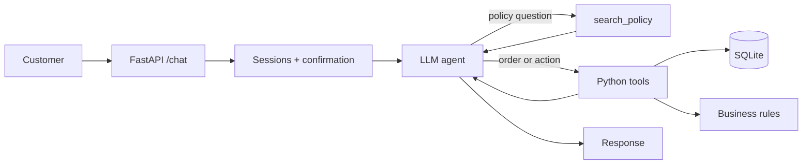
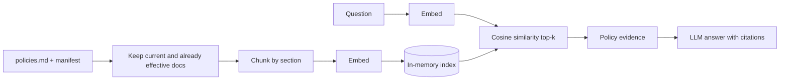

# ResolveBot

A chat assistant for the fictional electronics store ShopSphere. It answers policy questions from the store's policy documents, looks up a customer's orders, and can start returns and support tickets, always asking for a clear "yes" before anything is saved.

> **Status: work in progress (Stage 1, foundation only).** The `/chat` endpoint, the error codes and the configuration work. The assistant logic, tools and policy search are not built yet, so sections below that describe them say what is *planned*.

## Install and run

Requires Python 3.12 or newer (developed on 3.14).

```bash
python -m venv .venv
.venv\Scripts\activate          # macOS/Linux: source .venv/bin/activate
pip install -r requirements.txt
cp .env.example .env            # Windows: copy .env.example .env
# put the provided data files in ./data  (policies.md, manifest.json, shopsphere.db)
uvicorn app.main:app --port 8000
```

The `data/` folder is not part of the repository. The service starts even if no LLM key is set; chat requests then get a clear "assistant not available" reply instead of an error.

### Configuration

All settings are environment variables (or lines in `.env`). Real environment variables win over `.env`. Defaults are in `.env.example`.

| Variable | Default | Meaning |
|---|---|---|
| `POLICIES_PATH` | `./data/policies.md` | Policy documents |
| `MANIFEST_PATH` | `./data/manifest.json` | Document status and dates |
| `DB_PATH` | `./data/shopsphere.db` | Orders database |
| `APP_TODAY` | `2026-07-01` | The date the app treats as today |
| `LLM_PROVIDER` | `groq` | `groq` is implemented and tested. `openai` uses the same code path but is untested. `anthropic` and `google` are recognised but **not implemented**. |
| `LLM_MODEL` | `llama-3.3-70b-versatile` | Model name (not yet verified against a live key) |
| `LLM_TIMEOUT_SECONDS` | `20` | Per-request LLM timeout |
| `LLM_API_KEY` | (empty) | Generic key, used first if set |
| `GROQ_API_KEY`, `OPENAI_API_KEY` | (empty) | Used when `LLM_API_KEY` is empty and the provider matches |

Key lookup is in one place, `app/config.py`: `LLM_API_KEY`, then the selected provider's own variable. A key for a different provider is never borrowed. Key values are never logged or returned.

## Architecture

Planned request flow:



Planned policy search (RAG) path:



### Components

| Module | Status | What it does |
|---|---|---|
| `app/main.py` | built | The `/chat` endpoint. Checks the customer header (401), the body (400) and session ownership (403). |
| `app/config.py` | built | Reads all settings and resolves the API key. Nothing else touches environment variables. |
| `app/database.py` | built (partial) | SQLite access with parameterized queries. |
| `app/sessions.py` | built (partial) | In-memory sessions, each owned by the customer who started it. |
| `app/models.py` | built | The reply format. |
| `app/agent/llm.py` | built, not yet tested against a live key | The only file that calls an LLM (Groq via its OpenAI-compatible API, temperature 0). |
| `app/agent/orchestrator.py` | placeholder | Will run the tool loop, routing and confirmation. |
| `app/rules.py`, `app/tools/` | planned | Business rules (returns, warranty, cancellation) and the five tools. |
| `app/retrieval/` | planned | Policy loading, chunking, embeddings and search. |

### Request lifecycle (planned)

**A policy question** ("What is the return window?"): the agent calls `search_policy`; the question and the policy sections are embedded and the closest current sections are returned; the LLM answers only from those sections and the reply lists exactly the documents used.

**An action** ("Please return my earbuds from order SS-10458"): the agent calls the Python tools, which check the order belongs to the customer and whether the return is allowed. If it is, nothing is saved yet: the reply asks "Shall I go ahead?" and the session remembers the one pending proposal. Only if the very next message is a clear "yes" does Python re-check the rules and write to the database. Ownership, eligibility and confirmation are enforced by Python code, never left to the LLM.

## Experiments and Ablation Study

**Status: all experiments below are planned and NOT yet run. Every result cell is intentionally blank.** No scores, latencies or winners are claimed until an experiment is executed. Evaluation dataset size: not yet created. Method (when run): the same labelled retrieval questions for every configuration, written by the author, so the set is small and self-authored, which is a stated limitation.

Order of work: (1) baseline = MiniLM + structure-aware chunks + cosine + top-3; (2) compare the four embedding models; (3) compare chunking with the best practical embedding; (4) top-3 vs top-5; (5) hybrid BM25 only if the baseline misses exact terms; (6) answer-quality evaluation; (7) business-rule and security tests, run independently.

### Table A: Embedding model comparison

Fixed: structure-aware chunks, cosine similarity, top-5. Dimensions are filled in from the loaded model, not from memory.

| Model | Dimensions | Configuration | Recall@5 | Precision@5 | MRR@5 | nDCG@5 | Hit Rate@5 | Latency | Notes |
|---|---|---|---|---|---|---|---|---|---|
| `sentence-transformers/all-MiniLM-L6-v2` (baseline) | | no prefix | | | | | | | |
| `BAAI/bge-small-en-v1.5` | | query instruction prefix | | | | | | | |
| `intfloat/e5-small-v2` | | `query:` / `passage:` prefixes | | | | | | | |
| `sentence-transformers/all-mpnet-base-v2` | | no prefix | | | | | | | |

### Table B: Chunking comparison

Fixed: the best practical embedding from Table A. Limitation to record honestly: most policy sections are short, so fixed-size chunks may reproduce the section chunks; if so, that is reported rather than presented as a result.

| Strategy | Chunk configuration | Embedding model | Recall@5 | MRR@5 | nDCG@5 | Citation correctness | Latency | Notes |
|---|---|---|---|---|---|---|---|---|
| Structure-aware policy-section chunks | one chunk per `###` subsection | | | | | | | |
| About 128 tokens | 10–15% overlap, respecting section boundaries | | | | | | | |
| About 256 tokens | 10–15% overlap, respecting section boundaries | | | | | | | |

### Table C: Retrieval configuration comparison

Top-3 results cap Precision@5 at 3 items, so Recall and Hit Rate are reported at both cutoffs. Dot product on normalized vectors ranks identically to cosine, so it is a sanity check, not an independent contender.

| Configuration | Recall@5 | Precision@5 | MRR@5 | nDCG@5 | Hit Rate@5 | Latency | Notes |
|---|---|---|---|---|---|---|---|
| Cosine, normalized embeddings, top-3 | | | | | | | |
| Cosine, normalized embeddings, top-5 | | | | | | | |
| Dot product (diagnostic only) | | | | | | | |
| Hybrid BM25 + dense (only if needed after baseline) | | | | | | | |

### Table D: Generation and answer-quality evaluation

Generation model, prompt and parameters stay fixed while retrieval is evaluated. Rubric: *correctness, citation correctness, abstention accuracy* are pass/fail (1/0). *Faithfulness* (0 = a claim is unsupported by the retrieved text, 1 = partly supported, 2 = fully supported), *relevance* and *completeness* are scored 0–2. An LLM judge is not ground truth and is from the same provider as the generator; critical failures are checked by hand.

| Configuration | Answer correctness | Faithfulness / groundedness | Answer relevance | Citation correctness | Completeness | Abstention accuracy | Response latency | Notes |
|---|---|---|---|---|---|---|---|---|
| Baseline retrieval + fixed generation model | | | | | | | | |
| Best retrieval + fixed generation model | | | | | | | | |
| Alternative generation model (only if time permits) | | | | | | | | |

### Table E: Business-rule and safety validation

Functional tests, not embedding ablations. Test cases are added as the test suite is written.

| Test category | Test cases | Expected behaviour | Actual result | Pass/fail | Notes |
|---|---|---|---|---|---|
| Return eligibility | | | | | |
| Warranty boundary conditions | | | | | |
| Cross-customer isolation | | | | | |
| Confirmation before write | | | | | |
| Correct error codes and response routes | | | | | |
| Current-policy compliance | | | | | |
| Citation validity | | | | | |
| Clarification and no-answer behaviour | | | | | |

## Tests

```bash
python -m pytest
```

## Assumptions

To be completed as the application is built. Decided so far:

- With no usable LLM key the service still starts, and `/chat` answers with HTTP 200, route `no_answer` and a message explaining the assistant is unavailable (the assignment allows only 400, 401 and 403 as error codes).
- Check order is 401 (customer), then 400 (body), then 403 (session owner).
- Sessions are kept in memory and are lost when the service restarts.

## What does not work yet

Everything beyond the endpoint, error codes and configuration: no tools, no policy search, no assistant replies.

## Where AI assistants were used

To be completed.
